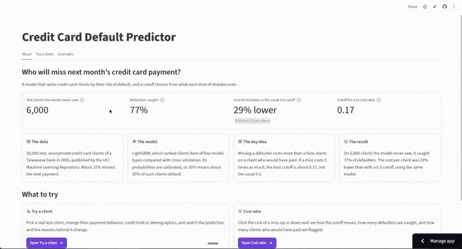

<div style="margin-bottom: 1.5rem;">
[Live App](https://credit-default-risk-2005-taiwan.streamlit.app/){.btn .btn-primary .wake-app-link target="_blank" rel="noopener" style="margin-right: 0.5rem; font-size: 1rem;"}
[View on GitHub](https://github.com/iangault/credit-default-risk){.btn .btn-secondary style="font-size: 1rem;"}

[<i class="bi bi-clock" aria-hidden="true"></i> The live app is on a free tier. If it has been idle, it can take up to a minute to start.]{.app-wake-note}
</div>

```{=html}
<div class="modal fade" id="wakeAppModal" tabindex="-1" aria-labelledby="wakeAppModalTitle" aria-hidden="true">
  <div class="modal-dialog modal-dialog-centered">
    <div class="modal-content">
      <div class="modal-header">
        <div class="modal-title fs-5 fw-semibold" id="wakeAppModalTitle">The app may be asleep</div>
        <button type="button" class="btn-close" data-bs-dismiss="modal" aria-label="Close"></button>
      </div>
      <div class="modal-body">
        <p>This app runs on Streamlit Community Cloud's free tier, which puts it to sleep after a period of no use.</p>
        <p class="mb-0">If you see a page saying the app has gone to sleep, click <strong>"Yes, get this app back up!"</strong> and give it up to a minute to start.</p>
      </div>
      <div class="modal-footer">
        <button type="button" class="btn btn-secondary" data-bs-dismiss="modal">Cancel</button>
        <a class="btn btn-primary" id="wakeAppContinue" href="https://credit-default-risk-2005-taiwan.streamlit.app/" target="_blank" rel="noopener">Open the app</a>
      </div>
    </div>
  </div>
</div>
<script>
document.addEventListener("DOMContentLoaded", function () {
  var modalEl = document.getElementById("wakeAppModal");
  if (!modalEl || !window.bootstrap) return;
  var modal = bootstrap.Modal.getOrCreateInstance(modalEl);
  function seen() {
    try { return sessionStorage.getItem("wakeAppNoticeSeen") === "1"; } catch (e) { return false; }
  }
  function markSeen() {
    try { sessionStorage.setItem("wakeAppNoticeSeen", "1"); } catch (e) {}
  }
  document.querySelectorAll(".wake-app-link").forEach(function (link) {
    link.addEventListener("click", function (e) {
      if (seen()) return;
      e.preventDefault();
      modal.show();
    });
  });
  document.getElementById("wakeAppContinue").addEventListener("click", function () {
    markSeen();
    modal.hide();
  });
});
</script>
```

{fig-alt="Screen recording of the Streamlit app"}

This project predicts which credit card clients will miss next month's payment, using the [Default of Credit Card Clients](https://archive.ics.uci.edu/dataset/350/default+of+credit+card+clients) dataset: 30,000 clients of a Taiwanese bank in 2005, of whom about 22% defaulted. The model ranks clients by risk, and the cutoff for flagging a client comes from what each kind of mistake costs rather than the usual 0.5.

It grew out of a group lab by Vy, Christine, and Ian Gault for DSCI 573 (Feature and Model Selection) in the UBC Master of Data Science program. The pipeline, experiments, app, and write-up in the public repository are a separate, individual rebuild. It was built with Claude Code as an AI-assisted project: I set the goals and made the design and modelling decisions ([how it was built](https://github.com/iangault/credit-default-risk#how-this-project-was-built)).

## What it does

- **Try a client** - pick a real test client (a defaulter the model caught or missed, a false alarm, or a correctly cleared client), change their payment behavior, credit limit, or demographics, and see the prediction and the columns that moved it most
- **Cost ratio** - change how much a missed defaulter costs compared with a false alarm, and see how the cutoff, the counts on 6,000 test clients, and the point on the ROC and precision-recall curves move
- **About** - the headline results and a short explanation of the approach

## How it works

- **Model comparison** - four model types compared with 5-fold cross-validation on the training data; LightGBM ranked clients best (ROC-AUC 0.776)
- **Class imbalance and engineered features** - weighting defaulters, resampling (fewer paying clients, or synthetic defaulters), and engineered columns each changed ROC-AUC by about 0.01 or less, so the final model uses none of them
- **Calibration** - a calibration step corrects the model's numbers so that a 30% score means about 30% of such clients default
- **Cost-based cutoff** - if a missed defaulter costs 5 times a false alarm, flagging is the cheaper choice above a probability of 1 / (1 + 5), about 0.17; a search over cutoffs on the training data found the same value
- **Test set** - 6,000 clients set aside at the start and scored once at the end; no choice about the model was made from them
- **Explanations** - SHAP values show which columns drive each prediction; last month's repayment status matters most

The full walkthrough, with figures, is in [docs/results.md](https://github.com/iangault/credit-default-risk/blob/main/docs/results.md).

## Results

On the 6,000 test clients:

| | Cutoff 0.17 (cost-based) | Cutoff 0.5 (default) | Flag everyone |
|---|---|---|---|
| Defaulters caught (of 1,327) | 1,016 (77%) | 472 (36%) | 1,327 |
| False alarms (of 4,673 who paid) | 1,650 (35%) | 229 (5%) | 4,673 |
| Cost per client (miss = 5, false alarm = 1) | **0.534** | 0.751 | 0.779 |

Choosing the cutoff from the costs lowers the cost of mistakes per client by 29%, with the same model. Ranking quality (ROC-AUC 0.788) is in the range published for this dataset.

## Technical stack

| Area | Tools |
|---|---|
| Modelling | scikit-learn, LightGBM, XGBoost, imbalanced-learn |
| Explanations | SHAP |
| Charts | Altair |
| App | Streamlit |
| Deployment | Streamlit Community Cloud |
| Reproducibility | conda, GNU Make, pytest, Ruff, GitHub Actions |

## Fairness note

The model uses sex, marital status, and age, which is a fairness concern. In many places a lender could not base a decision on some of them. Checking error rates by group, and comparing the model with and without these columns, is listed as future work.
